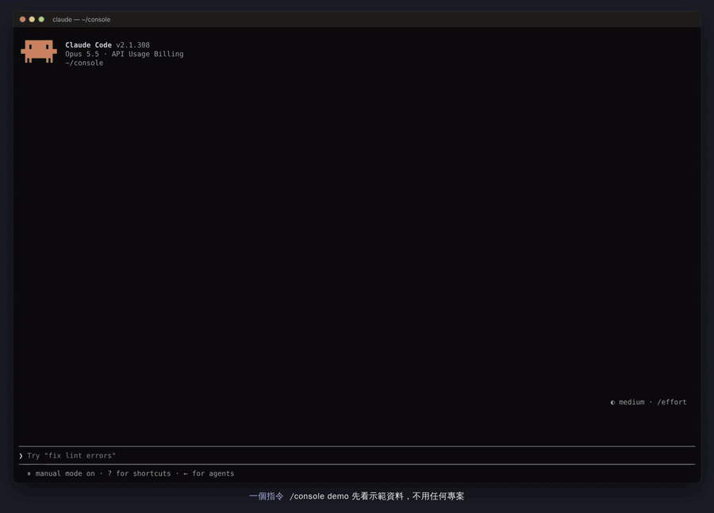

# claude-console

**在 Claude Code 裡同時顧好幾個專案的主控台。** 一個面板看完每個專案卡在哪、在等誰；決策用按的、派工一鍵、Git／PR／CI 與額度都在旁邊，不用切視窗。

<p align="center"><a href="docs/demo.mp4"></a></p>
<p align="center"><a href="docs/demo.mp4">▶ 觀看 65 秒示範影片（MP4）</a> · <a href="#版本紀錄">版本紀錄</a> · <a href="README.en.md">English</a></p>
<p align="center"><sub>Claude Code 2.1.308 與 console-status 0.32.0 在終端機中的實際畫面（tmux 逐格擷取後轉成影片）。前半段是 <code>/console demo</code> 的示範資料，後半段是<a href="scripts/demo-video">錄影腳本</a>建立的五個 Git 專案；下方字幕與滑鼠指標為後製加上，錄影環境自己的啟動警告也拿掉了。</sub></p>

## 快速開始

1. **安裝。** 在 Claude Code 裡輸入這兩行，裝好就能用，不用重開。安裝時跳出的設定畫面按 Esc 關掉就好，全部用預設值。用終端機安裝見[安裝](#安裝)。

   ```text
   /plugin marketplace add SaM-runtime/claude-console
   /plugin install console-status@claude-console
   ```

2. **先看示範。** 輸入 `/console demo`，不用任何專案就能看到完整面板；`/console refresh` 換回自己的資料。
3. **加入專案。** 在專案資料夾開 Claude Code，輸入 `/console add`。登錄表和狀態卡（`.console/STATUS.md`）會自動建好，每個專案做一次（見[加入專案](#加入專案)）。
4. **開始用。** 在任何一個對話輸入 `/console` 打開面板。在專案的狀態卡寫上「下一步」（動作選單按 `o` 開檔，把 `- 下一步：無` 改成要做的事），再按 `⇢ 繼續下一步`，背景執行者就會去做。之後在等你的事會排在「下一步」卡，按 `n` 一件一件看。

設定都有預設值，不改也能用；要改見[設定](#設定)。

## 功能一覽

- **一張表看全部專案。** 每個專案一列：狀態（`●` 需決策、`◆` 待審核、`▶` 執行中、`↻` 待同步、`○` 閒置）、六格流程管線（規格 → 實作 → 同步 → 驗證 → 審核 → 上線）、更新時間與 Git 摘要。最上方的「下一步」卡指出現在該處理哪一件，沒有事在等你時，改成指出可以繼續的專案（`⇢ 沒有在等你，可以繼續`，旁邊就是「繼續下一步」按鈕）；閒置專案有下一步時，列上顯示 `⇢ <下一步>`，和真的沒事做的專案分得開；有事沒做卻好幾天沒動的專案，更新時間轉成琥珀色、標出「久未動」，並優先被建議繼續（`staleDays`）。按 `n` 依序跳到每一件在等你的事（決策、關卡、待同步、CI 失敗、驗證沒過）並打開它的動作選單，`/console inbox` 用文字列出同一份清單。面板關起來時，輸入框上方的橫帶仍顯示各狀態數量。見[專案動作](#專案動作)與[流程管線與專案模式](#流程管線與專案模式)。
- **決策用按的。** 卡片裡每個選項都能直接點；動作選單開著時，數字鍵依序作答（按 `2` 再按 `1` 就是 `1B 2-1`），Backspace 退回上一個。`✎ 填入決策` 或 `✎ 做決定` 把答案放進輸入框，按 Enter 送出。
- **一鍵動作。** 驗證、同步 STATUS、繼續下一步、審核關卡、開啟 STATUS.md：右鍵或 `m` 開動作選單，每個動作都有單鍵快捷。執行者做完卻沒寫回 CARD 時，主控台會自動派一次同步（`autoSync`），同步進度一步一步顯示。執行者停下來問你時，直接在主控台回覆（`↩ 回覆執行者`），不用切過去；執行者是因為出錯（登入失效、額度用完）停下的，會直接寫出原因，按 `↻ 重試` 接回同一個對話；卡住的工作用 `■ 停止工作`（`x`）停掉，要批准權限時用 `↗ 接手對話`（`t`）；下一步會以灰字建議放在輸入框，按 Tab 再 Enter 就好（`suggestNext`）。按 `⟳ 自動接力`（`a`）則讓面板替你一路按下去：繼續、同步、把關卡交給主控台，每次更新最多一跳；狀態卡有 `驗證` 時每跳之間先跑一次，停在需要你拍板的決策、執行者提問、release 關卡、失敗、驗證沒過、跳數上限或額度門檻。
- **派工可選執行者。** 預設用 Claude Code 背景 agent，也可整體或單一專案改用 Codex；Codex 不能用或額度不足時可退回 Claude。選取專案後送出的提示會附上「執行者摘要」（最後在做什麼、最後三個工具呼叫、最後一句話），專案卡的「執行者」區塊也顯示同樣內容。見[派工設定](#dispatch-settings派工設定)。
- **Git、PR 與 CI 不用切視窗。** 分支與領先／落後、未提交行數、stash、最近幾筆提交、fetch 太久沒更新的提醒；`▸ 檔案` 展開依 `git status` 分組的檔案清單，`▸ 分支圖` 展開彩色的分支／合併圖；PR 審查狀態與失敗的 CI 檢查，CI 失敗時橫帶亮紅。見 [Git、PR 與 CI](#gitpr-與-ci)。
- **用量與快取。** Claude 的 5 小時、本週、各模型額度與 Codex 額度在同一張「用量」表，並估算照目前速度何時用完；提示快取的倒數、冷掉後重寫的費用與上次命中率。見[用量配速](#用量配速)與[快取與費用](#快取與費用)。
- **護欄。** 不可逆的指令（`rm -r`、force push、`git reset --hard`、`DROP TABLE` 等）先問你；同一個工具呼叫以同樣錯誤失敗兩次，就不讓模型試第三次。見[指令護欄](#指令護欄)與[重複失敗護欄](#重複失敗護欄)。
- **一個指令加入新專案。** 在專案資料夾裡輸入 `/console add`：寫進登錄表（沒有就建立）、放好 `.console/STATUS.md`、把 `.console/` 加進 `.git/info/exclude`，不用手寫表格。見[加入專案](#加入專案)。
- **專案多了也好管。** 暫時不碰的專案按 `⊟ 封存` 收進登錄表的「已封存」段落，主控台不再更新它；常用的按 `▴ 置頂`，排在同一個狀態的最前面，也先被建議繼續。離開主控台一陣子再回來，「下一步」卡上面會先列出這段時間發生的事：完成幾個工作、幾個失敗、幾件新的在等你（`awayMinutes`）。見[封存與置頂](#封存與置頂)與[離開期間摘要](#離開期間摘要)。
- **只在需要的 session 啟動。** 預設只有輸入過 `/console` 的 session 跑主控台（resume 後自動再啟動），其他 session 只有護欄；在已登錄專案的資料夾裡會切到專案模式。見[輕量 session](#輕量-session)。
- **面板內更新。** 頁尾顯示目前版本，有新版時按 `⬆ 更新` 或輸入 `/console update`。見[升級](#升級)。

各版本的完整變更見 [CHANGELOG.md](CHANGELOG.md)。

## 運作方式

`claude-console` 是本機多專案 Claude Code mod。單一主控台 session 負責各專案的規格、監督與審核關卡；操作者只提供決策，並在最後決定是否 release。

`console-status` mod 讀取精簡 STATUS 卡與受管理的執行器狀態，提供觸發式動作。驗證、派工、同步 STATUS 與審核都從按鈕直接開始，結果會寫入動態 feed。面板不會執行 release 或正式環境變更。

派工執行器可以切換。預設 `claude` 使用 Claude Code 原生背景 agent，不需要 Codex 帳號；Claude 額度有限時，可選 `codex` 改走 Codex Companion。

面板刷新會查詢本機檔案與 CLI，並在觀察結果變更時更新 mod 自有的受管理狀態；刷新本身不會請求模型。決策草稿只有在操作者送出後才使用 Claude 額度。目前 UI 為繁體中文。

## 需求

- Windows、macOS 或 Linux（macOS 與 Linux 使用內附的 POSIX `sh` 探測腳本，不需要 PowerShell）
- Claude Code 2.1.291 以上（CI 在這一版和最新版上測試）
- 一份專案登錄表，以及每個專案各一份 STATUS 檔：`/console add` 會自動建立，也可以照[範例](workflow/projects-scope.example.md)自己寫
- 只有 `executor: codex` 需要 Node.js、Codex Companion 與 Codex 帳號。Windows 探測需要 PowerShell 與 Codex 桌面應用程式；macOS 探測需要 `PATH` 上有 `codex` CLI（會自動補上 Homebrew 路徑）

## 安裝

在 Claude Code 裡（裝好立刻生效）：

```text
/plugin marketplace add SaM-runtime/claude-console
/plugin install console-status@claude-console
```

或在終端機（之後開的 Claude Code 對話都會載入）：

```powershell
claude plugin marketplace add SaM-runtime/claude-console
claude plugin install console-status@claude-console
```

直接使用這份 checkout：

```powershell
claude plugin marketplace add .
claude plugin install console-status@claude-console
```

Marketplace 管理請參考官方 [plugin marketplace 文件](https://code.claude.com/docs/en/plugins/cli-reference#plugin-marketplace-add)。

## 設定

不設定也能用，每一項都有預設值（見下表）。要改的時候：

- 在 Claude Code 輸入 `/plugin configure console-status@claude-console`，選要改的項目，最後選 **Save configuration**；
- 或在終端機執行 `claude plugin configure console-status@claude-console` 看目前的值，用 `--values-stdin` 改：傳入的 JSON 每個值都是單行字串，沒寫到的設定保留原值。

```powershell
echo '{"registryPath": "D:/Work/projects-scope.md", "staleDays": "5"}' | claude plugin configure console-status@claude-console --values-stdin
```

| 項目 | 用途 | 預設值 |
| --- | --- | --- |
| `registryPath` | 專案名稱與 STATUS 檔的 Markdown 登錄表 | `~/.claude/handoffs/projects-scope.md` |
| `dispatchSettingsPath` | 共用執行器、模型與 effort 設定 | `~/.claude/handoffs/dispatch.json` |
| `claudeSessionsPath` | 受管理的 Claude session 對應檔 | `~/.claude/handoffs/claude-sessions.json` |
| `executor` | 設定檔缺少或無效時的執行器 | `claude` |
| `defaultModel` / `defaultEffort` | 模型備援值；空白交給執行器原生預設 | 空白 |
| `companionScript` | `executor: codex` 使用的 Companion 腳本；空白或已失效時自動改用最新安裝的 Codex plugin | 空白 |
| `companionStateDir` | 舊版 companion state 根目錄，也傳給 Codex preflight | 系統 Temp 的 `codex-companion` |
| `companionStateRoots` | 以字串編碼的 JSON 路徑陣列，覆寫 Codex job 來源 | 先 plugin data，再舊版 Temp |
| `modelsCachePath` | Codex 模型與 effort 快取 | `~/.codex/models_cache.json` |
| `codexFallback` | Codex 無法使用時的處理：`ask`、`claude`、`off` | `ask` |
| `codexMinQuotaPercent` | Codex 額度剩餘百分比低於此值時啟用備援 | `10` |
| `gitProbe` | `on`：每個專案的 Git 狀態（分支、未提交、未推送）以及透過 `gh` 讀取的 PR 與 CI 檢查；`git`：只讀本機 Git；`off`：都不讀（見 [Git、PR 與 CI](#gitpr-與-ci)） | `on` |
| `gitGraph` | 分支圖的畫法：`spaced` 像 VS Code Git Graph，每個提交一個圓點，提交之間多一列畫線與分支轉彎；`line` 一個提交一列，提交是分支線上較亮較粗的一段；`dot` 一個提交一列，提交畫成圓點（0.22.0 的樣子）。分支圖標題列的 `樣式：…` 可在這個對話裡依序切換 | `spaced` |
| `commandGuard` | `ask`：無法復原的 shell 指令先問你（見[指令護欄](#指令護欄)）；`deny`：一律拒絕；`off`：關閉 | `ask` |
| `loopGuard` | `on`：工具呼叫以相同參數、相同錯誤連續失敗兩次時，提醒模型不要第三次照原樣重試（見[重複失敗護欄](#重複失敗護欄)）；`off`：關閉 | `on` |
| `cacheHint` | `on`：顯示主控台 prompt 快取倒數與重寫費用（見[快取與費用](#快取與費用)）；`off`：隱藏 | `on` |
| `cacheTtl` | `auto`（讀 session 記錄裡 API 回報的實際 TTL，讀到前先當 5 分鐘）、`5m` 或 `1h` | `auto` |
| `cacheWritePrice` | 估算用的快取寫入單價（每百萬 tokens 美元）；空白使用模型牌價 | 空白 |
| `autoSync` | `on`：執行者已結束、但結果沒寫回 CARD（待同步）時，主控台自動派一次同步，每個工作只派一次；失敗或沒寫回的同步不會重試。工作結束後先等 60 秒，這段時間內若你已繼續或回覆（專案有新工作在跑），這次同步就不派；停下來問你的工作也不自動同步。`off`：只有按「同步」才會同步 | `on` |
| `cycleMaxHops` | 每按一次 `⟳ 自動接力` 最多派幾跳（繼續、同步或送主控台審核關卡），1–20；空白或不是數字＝預設。到了就停，交回給你 | `6` |
| `cycleQuotaStop` | 自動接力的額度煞車：Claude 的 5 小時額度用到這個百分比（1–100），或任一額度照目前速度一小時內會用完，就在下一跳前停下，也不能再按 ⟳；額度數字超過 45 分鐘沒更新（主控台一直沒回應）也一樣停下；`off` 關閉額度煞車（跳數上限照舊）。Codex 自己的額度仍看 `codexMinQuotaPercent` | `70` |
| `confirmContinue` | `on`：`⇢ 繼續下一步` 與 `↻ 重試` 要在六秒內按第二次才派工（防誤按）；`off`：按一次就派。自動接力本來就不用按第二次 | `on` |
| `staleDays` | 有事沒做（決策、關卡、待同步或下一步）的專案，狀態卡超過幾天沒更新就標「久未動」（1–60）：更新時間轉琥珀色，「下一步」卡與 Tab 建議優先挑它繼續；`off` 關閉 | `3` |
| `awayMinutes` | 超過幾分鐘（5–1440）沒用這個主控台（沒送提示、沒打 `/console` 指令、沒在面板按鍵或按按鈕），回來時先列出這段時間發生的事（見[離開期間摘要](#離開期間摘要)）；`off` 關閉 | `30` |
| `suggestNext` | `on`：把下一步（決策、回覆停下來問你的執行者、審核關卡、同步、繼續）以灰字建議放在輸入框，按 Tab 採用（見 [Tab 接受下一步](#tab-接受下一步)）；`off`：輸入框只留 Claude Code 自己的建議 | `on` |
| `activation` | `auto`：只有執行過 `/console` 的 session 會跑主控台，resume 同一個 session 會自動再啟動；其他 session 只有指令護欄（見[輕量 session](#輕量-session)）。`always`：每個互動 session 都跑，但非互動 session 與主控台自己派出去的執行者 session 仍只有護欄 | `auto` |
| `projectMode` | `auto`：在已登錄專案內開啟的 session 會切到專案模式（見[流程管線與專案模式](#流程管線與專案模式)）；`off`：一律是多專案主控台 | `auto` |

Windows、macOS、Linux 都會展開開頭的 `~`。改完設定後執行 `/reload-plugins` 或開新的 Claude Code 對話才會生效。登錄表格式見 [範例](workflow/projects-scope.example.md)。

### 加入專案

在專案資料夾開 Claude Code，輸入 `/console add`（或在主控台輸入 `/console add <資料夾>`）：

- 把資料夾寫進 `registryPath` 的登錄表，名稱用資料夾名稱（重複時加編號，之後可以直接改表格）；還沒有登錄表就建立一份；
- 資料夾裡沒有 `.console/STATUS.md` 時，照 [STATUS 範本](workflow/STATUS-template.md) 建立一份，狀態卡寫「剛加入主控台」；已經有的就沿用；
- 是 git repo 時，把 `.console/` 加進 `.git/info/exclude`，STATUS 不會被 commit（要納入版本控制就刪掉那一行）。

那個對話不會因此變成主控台；開著的主控台會立刻刷新，新專案馬上出現在表上。接著把狀態卡的 `- 下一步：無` 改成第一件要做的事（動作選單按 `o` 開檔），就能按 `⇢ 繼續下一步`。從別的資料夾加入時要注意：Claude Code 要先在那個資料夾開過一次並選「信任」，才能在那裡跑背景工作。另一個專案的資料夾也叫同一個名字時，`/console add` 會提醒你：用 Codex 派工時，兩邊的 Codex 工作分不開。

面板、選單和指令都用名稱找專案。登錄表裡同一個名稱寫了兩次（大小寫不同也算）時，第二個在面板上先顯示成「名稱 2」，專案清單下方會提醒你改表格；同一張狀態卡列了兩次只顯示第一列。指令裡的專案名稱可以只打開頭（`/console continue ap`）；開頭符合好幾個專案時，會列出可能的名稱請你打完整，不會自己挑一個。

### 封存與置頂

專案多了以後，暫時不碰的可以封存，常用的可以置頂。兩個按鈕都在動作選單的「清單」那一行，也都有指令。

- **⊟ 封存**（`/console archive <專案>`）：把那一列從登錄表的 `## STATUS 卡位置` 搬到同一個檔案的 `## 已封存` 段落（第一次封存時建在檔案最後，表頭相同）。主控台不再更新它：不讀狀態卡、不跑 git 和 `gh`，面板最下面只留一行 `⊟ 已封存 2：api・docs`。工作還在跑時不能封存；這個主控台在它身上的自動接力會一起停掉。
- **↺ 取回**：按那一行的 `▸ 取回` 列出已封存的專案，再按要的那個 `↺ 取回`；或輸入 `/console unarchive <專案>`（不加名稱就列出全部）。也可以直接在登錄表把那一列搬回 `## STATUS 卡位置`。對已封存專案的資料夾執行 `/console add` 會直接取回，不會登錄兩次；新加入的專案也不會取跟已封存專案一樣的名字。
- **▴ 置頂**（`/console pin <專案>`，加上 `off` 取消；只輸入 `/console pin` 列出置頂的專案）：同一個狀態裡排在最前面，名稱前面有 `▴`；沒有事在等你時，「下一步」卡與 Tab 建議先挑它繼續（比久未動的專案優先）；按 `n` 時，同一種待辦也先跳到它。置頂記在外掛自己的儲存區，每個主控台都一樣，不動登錄表。

## Dispatch settings（派工設定）

正式檔案是 `~/.claude/handoffs/dispatch.json`（`dispatchSettingsPath`），保存全域 executor、model、effort，以及可選的專案覆寫：

```json
{
  "executor": "claude", "model": "", "effort": "",
  "projects": {
    "D:/Projects/api": { "executor": "codex", "model": "", "effort": "high" },
    "D:/Projects/legacy-portal": { "executor": "manual" }
  }
}
```

沒有 `projects` 的 0.1 平面格式照常可用。`dispatch.json` 不存在時，會讀取同目錄的舊版 `codex-dispatch.json`（唯讀；舊檔沒有 `executor` 時視為 `codex`）。所有寫入都寫到 `dispatch.json`。

### 專案執行者

每個專案依下列順序決定執行者：

1. 面板覆寫：`dispatch.json` 的 `projects["<根目錄>"]`。Key 是專案根目錄；Windows 磁碟與 UNC 路徑不分大小寫比對。
2. 登錄表：登錄表表格可選的 `Executor` 欄（`claude`、`codex`、`manual` 或空白）。沒有此欄的登錄表照舊解析。
3. 全域：`executor` 欄位。

Model 與 effort 依相同順序。專案執行者與全域不同時，不沿用全域的 model 與 effort，因為那些值屬於另一個執行器。

`manual` 代表面板永不派工該專案：隱藏同步與繼續，卡片顯示交接提示；CARD、驗證、決策與關卡照常。

展開的專案卡與右鍵選單中的 `執行者` 一列提供 `沿用`（會標出沿用的值與來源）、`claude`、`codex`、`manual`，按一下即選定，目前的選擇以方括號標示。面板會立即更新，之後的 refresh 在背景執行。`/console project executor|model|effort <值|inherit> <專案名稱>` 設定相同欄位，`/console project` 列出實際生效的設定。

同一專案可能同時有兩種執行器的工作（切換執行者或 Claude 備援之後）。工作清單會合併兩種執行器；任一執行器有執行中或排隊中的工作，就顯示 RUNNING 並阻止重複派工。

面板標題下方的 executor、model、effort 都是 plain Button。點一下會在下一行展開該設定的可選值，目前的值以方括號標示，`預設` 代表交給執行器決定；點選一個值會寫入檔案並顯示 toast，點目前的值、`✕` 或再點一次標籤則收起。強度選項跟著所選模型。讀不到 Codex 模型快取時，模型只列 `預設` 和目前的值，並提示改用 `/console model <name>`。手機沒有 Client 時也會呈現 Button。設定套用到下一次派工，執行中的任務保留自己的請求值。

下列指令顯示或設定相同內容：

```text
/console executor
/console executor claude
/console model
/console model <name>
/console effort <level>
```

`/console model ""`、`/console effort ""` 會恢復所選執行器的預設。檔案不存在、損壞或無法讀取時，使用 `executor`、`defaultModel`、`defaultEffort`。

### 同步模型

同步 STATUS 只寫 CARD 與歷程，可以用比實作便宜的模型。預設什麼都不設：沒選之前，同步跟其他派工用一樣的模型與 session。依執行者分開設定，因為 Claude 和 Codex 帳號的模型不同：

```json
{
  "executor": "claude", "model": "opus", "effort": "high",
  "sync": { "claude": { "model": "haiku" }, "codex": { "model": "luna", "effort": "low" }, "session": "fresh" },
  "projects": { "D:/Work/Beta": { "sync": { "session": "resume" } } }
}
```

- 模型名稱是自由文字，照你的帳號有的填。空白欄位沿用一般派工的模型或強度；專案的 `sync` 欄位優先於全域。
- `session`：`fresh` 開一個新的小 session，讀 STATUS.md、`git log`／`git status` 與執行者摘要，並只寫這些看得到的事實。`resume` 照舊接續專案的 session。不設時，Claude 有同步模型就用 `fresh`（便宜模型接續長 session 會用新模型的價格重寫整段快取），Codex 維持 `resume`，因為下一次繼續的 `--resume-last` 會接到 fresh 同步的 thread，而不是工作的 thread。執行者停下來問你的那一列，同步一律接續那個 session。
- 用同步模型時都會提醒：接受通知寫 `（用 haiku・新對話）`，同步列寫 `claude（haiku・新對話） 寫回中`。同步模型啟動失敗時，主控台立刻改用原本的模型再同步一次並告訴你；用它的同步失敗或沒寫回 CARD 時，也會跳提醒。兩種情況之後的同步都改用原本的模型，直到你重新設定同步模型。
- 面板標題下的 `同步模型` 控制選全域執行者的同步模型（`同派工` 為清除）；同步會開新對話時旁邊標 `新對話`，展開的選項列會寫明是哪個執行者的，例如 `同步模型（claude）`。`/console sync-model [claude|codex] <名稱>`、`/console sync-effort [claude|codex] <強度>`、`/console sync-session fresh|resume` 設定相同欄位；`""` 清除，只輸入 `/console sync-model` 會列出目前設定。

### executor: claude

這是預設執行器，使用 Claude Code 原生背景 agent，不需要 Codex Companion 或 Codex 帳號。

Mod 會在 `claudeSessionsPath` 保存專案與 session 的對應，以及每個專案最近 20 筆受管理工作。第一次派工以專案為工作目錄並用原生背景模式啟動，後續以對應的完整 session ID resume。Claude Code 2.1.289 的本機 help 記載了 `--bg`、`--resume`、`--continue`。Mod 以 `--bg` 搭配唯一的 `--name` 啟動，透過 agents 清單確認回傳的短 ID，再以保存的完整 session ID resume。它不使用 `--continue --bg`，因為這個組合會選擇該工作目錄最近的 session，而不是明確指定受管理 session。

`claude agents --json --all --cwd <專案根目錄>` 會列出執行中與已完成 agent。Mod 只接受 `cwd` 完全符合專案的 background agent，使用其短 `id`、完整 `sessionId`、`name`、`state`、`status`、`waitingFor`，並以 `claude logs <id>` 讀取輸出。派工必須透過唯一名稱對應到一個新產生的完整 session UUID 才會保存；無法唯一確認時保持未解狀態並阻止再次派工，後續刷新可恢復唯一具名的派工。Blocked 或 waiting 仍算執行中，查不到 agent 也不推定完成。本機樣本觀察到 `working`、`blocked` state 與 `busy`、`idle`、`waiting` status；文件定義的終止 state `done`、`failed`、`stopped` 會結束受管理工作。

Windows 上 `claude` 常是 npm 安裝的 `claude.cmd`，它會經過 cmd.exe：參數遇到換行就被截斷、遇到 `&` 會被拆開，所以多行的派工提示只剩第一行。因此在 Windows 上，派工提示改從標準輸入交給 `claude --bg`（0.32.1 起；原生安裝的 `claude.exe` 也一樣），macOS 與 Linux 仍放在最後一個參數。

Session 檔是 mod 自有狀態。內容損壞時會 fail closed，不會丟棄已保存的 session 身分。同一 mod process 內的寫入會序列化，因此請只讓一個主控台 process 寫入；不同 process 同時寫入不保證 atomic。Claude 派工不加入略過權限的旗標，沿用一般 Claude Code 權限流程。背景 agent 做完一輪停在提問時，用 `↩ 回覆執行者` 在主控台回覆即可（見[專案動作](#專案動作)）；停在權限提示（等待批准）的，按 `↗ 接手對話` 接手那個對話處理。

模型 Button 提供 CLI 已觀察到的 alias：`fable`、`opus`、`sonnet`、`haiku`；`/console model <name>` 也接受自由輸入。Effort 為 `low`、`medium`、`high`、`xhigh`、`max`。空值交給 Claude Code 決定。

Claude Code 官方 [agent view](https://code.claude.com/docs/en/agent-view) 是背景 agent 的檢視與控制介面；旗標的現行定義以 [CLI reference](https://code.claude.com/docs/en/cli-reference) 為準。此 mod 只保存延續專案所需的受管理 session 身分。

### executor: codex

Claude 額度有限時可選這個執行器。派工前先設定 `companionScript`，並確認 Codex Companion 能使用其帳號。

Codex 模型順序取自 `models_cache.json` 的 `models[].slug`。Effort 取自 `supported_reasoning_levels[].effort`；沒有模型專屬資料時，備援為 `low`、`medium`、`high`、`xhigh`。快取不可用時保留目前值，改用 `/console model <name>`；空的 model 或 effort 會省略對應旗標，使用 Codex 預設。

Job 預設先讀 `~/.claude/plugins/data/codex-openai-codex/state`，再讀舊版 Temp 根目錄。同 ID 使用較新的 `updatedAt`，缺少時採 state 時間；同時間保留先讀來源。可用例如 `"companionStateRoots": "[\"~/jobs/current\",\"~/jobs/legacy\"]"` 覆寫。這個設定不影響 Codex quota 或 preflight。

內附 preflight 會在 Codex 派工前檢查 Codex 串接腳本（companion）與 Codex 背景程式（broker）。Quota 取自本機最新可用 Codex 紀錄，可能過期。派工受理只代表 companion 收到工作；完成與審核仍要看 STATUS 證據與本機驗證。

#### Companion 自動選用

`companionScript` 空白，或 preflight 回報設定的檔案 `MISSING`（Codex plugin 每個版本安裝在各自的快取資料夾，更新後固定路徑會失效）時，mod 會在 `~/.claude/plugins/installed_plugins.json` 中 `codex@openai-codex` 的 installPath 與 `~/.claude/plugins/cache/openai-codex/codex/<版本>/scripts/codex-companion.mjs` 之間，選出實際存在腳本的最新語意版本。頁尾會顯示使用中的路徑並標示 `自動選用`；設定路徑失效時附上警告。

#### 額度與背景程式備援

每次 Codex 派工前會檢查最近的探測結果：

- Codex 額度電池顯示剩餘量（取最低的時間窗）低於 `codexMinQuotaPercent`，或
- preflight 回報此專案的 Codex 背景程式還是舊版（Codex app 更新後舊的背景程式沒關）、找不到 Codex app，或找不到 Codex 串接腳本。面板會顯示 `Codex 已更新，但背景程式還是舊版（PID …），派工會失敗；先關掉它：! for p in …; do taskkill …; done`，照著執行即可。

超過六小時的額度資料仍會顯示，但視為未知，不會單獨觸發備援。接著：

| `codexFallback` | 行為 |
| --- | --- |
| `ask`（預設） | 不派工。Toast 與專案卡說明原因，並提供 `⇢ 改用 Claude 派工`，把同一個提示交給 Claude。 |
| `claude` | 把同一個提示交給 Claude 執行器，並在工作上記錄 `fallbackFrom: "codex"` 與原因。 |
| `off` | 0.1 行為：一律派給 Codex。 |

Claude 代為執行的工作在任務清單標示 `codex→claude`。只有全域執行器是 `claude` 時才沿用其 model 與 effort，否則使用 Claude Code 預設。

#### CLAUDE.md 片段

把以下內容貼進使用者 `CLAUDE.md`，讓手動派工的主控台也依同一份檔案：

```markdown
## 派工設定
派工給任何執行器前，先讀 ~/.claude/handoffs/dispatch.json
（不存在時讀 ~/.claude/handoffs/codex-dispatch.json；不要寫入它）。
- 全域："executor"（claude | codex）、"model"、"effort"。
- 專案："projects"["<專案根目錄>"] 可設定 "executor"（claude | codex | manual）、
  "model"、"effort"；Windows 路徑不分大小寫比對。優先序：projects > 登錄表 Executor 欄 > 全域。
- 非空的 model/effort 各以單一 --model / --effort 傳入；空值省略。
- "manual" 代表不派工該專案，改為整理交接內容給使用者。
```

## STATUS 卡

每份 STATUS 檔包含一個以 `<!-- CARD -->`、`<!-- /CARD -->` 包住的機器可讀區塊，維持十行以內。Parser 認得 [範本](workflow/STATUS-template.md) 中的繁體中文 key，包括 `更新`、`狀態`、`驗證`、`等使用者`、`下一步`、`關卡`。

`關卡` 填 `無`、`spec：…`、`review：…` 或 `release：…`。無法辨識但非空的關卡也會阻止繼續。Git 專案可把本機 STATUS 放在 `.console/STATUS.md`，需要保持本機時加入該 repo 的 `.git/info/exclude`。

## 專案動作

右鍵選單（鍵盤可在游標所在列按 `m` 開啟、Esc 關閉）與展開的專案卡提供相同動作。按 `n` 會跳到下一件在等你的事並打開它的選單（依急迫程度：決策、關卡、待同步、CI 失敗、驗證沒過；最後一件之後回到第一件）。選單開著時，數字鍵依序回答待決（`2` 再 `1` 就是 `1B 2-1`），Backspace 退回上一個選擇；「做決定」與 `d` 會把已選的答案一併填入輸入框。選單會顯示專案狀態與管線、正在執行的任務（已跑時間與最後一行輸出），以及 CARD 的待決、關卡與下一步；因工作執行中而無法派工時，以「派工鎖定：…」文字說明，不再顯示無法按的按鈕；手機使用卡片 Button。每個觸發會立即 toast、執行中顯示已經過秒數並拒絕重複啟動，結束後把結果寫入動態。鍵盤游標跟著專案走：刷新後列的順序變了，游標還停在同一個專案上。一次刷新最多跳 3 則通知（新的決策、關卡、執行結果等），更多時第 3 則改成「另有 N 則更新，見主控台動態」，全部都寫在動態裡。

| 動作 | 出現條件 | 行為 |
| --- | --- | --- |
| ▶ 執行驗證 | CARD 有 `驗證` | 在專案根目錄執行，最長五分鐘；不花模型額度 |
| ⇢ 同步 STATUS | SYNC，且執行者不是 `manual` | 派該專案的執行器只更新 CARD 與歷程；`autoSync: on` 時每個結束的工作會自動派一次 |
| ⇢ 繼續下一步 | IDLE、有下一步、無待決或關卡，且執行者不是 `manual` | 六秒內再按一次後派該專案的執行器（面板會顯示將派出的下一步）；`confirmContinue: off` 時按一次就派 |
| ↩ 回覆執行者 | Claude 執行者做完一輪停下來問你，且執行者不是 `manual` | 在輸入框填入 `/console reply <專案> `，寫下回覆按 Enter，主控台就用你的話接續問問題的那個 session（附上和「繼續」相同的 CARD 規則），不用 attach。權限提示（等待批准）用 `↗ 接手對話` |
| ↻ 重試 | 同上，但執行者是因為出錯停下的（最後一則是 API 錯誤，例如登入失效、API key 無效、額度用完、服務出錯） | 列上寫「執行者出錯：<原因>」，不再說「在等你回覆」；額度用完時附上重置時間。排除原因後六秒內按兩次（`confirmContinue: off` 時按一次），接回同一個對話從中斷的地方繼續。自動接力停在「執行者出錯：<原因>」 |
| ■ 停止工作 | 專案有工作在跑 | 六秒內按兩次確認：Claude 用 `claude stop <代號>`，Codex 用串接腳本的 `cancel`。也會停掉這個主控台在這個專案的自動接力。已經寫好的檔案不會還原，之後可以同步或繼續 |
| ↗ 接手對話 | 有執行中或停下來問你的 Claude 對話 | 在 Windows Terminal 裡開一個新分頁、在專案資料夾執行 `claude attach <代號>`；其他終端機會複製這行指令讓你貼上。用來批准權限、看它在做什麼，或直接跟它說話 |
| ⇢ 改用 Claude 派工 | `codexFallback: ask` 擋下的 Codex 派工 | 把同一動作交給 Claude，並記錄為備援 |
| ✎ 做決定 | `等使用者` 非空，且該專案沒有工作在跑 | 預填草稿並附一次性專案 context；送出時才使用 Claude。展開卡片中每個選項都可按下，`✎ 填入決策：1A 2B` 會填入已選的答案 |
| ⚑ 審核關卡／最終審核 | 可辨識的 spec、review、release | 交主控台 Claude 審核；release 審核不會執行 release。該輪結束、CARD 關卡變更，或十分鐘內沒有審核輪在跑，這一列就會解鎖 |
| ⟳ 自動接力／■ 停止接力 | 執行者不是 `manual`、有狀態卡、專案不是「需決策」 | 按下後，每次更新替你按一個現有按鈕：IDLE 有下一步→繼續（不用六秒內再按）、spec／review 關卡→交主控台審核（同一個關卡只送一次）、待同步→交給 `autoSync`（關掉時自己派一次同步）。狀態卡有 `驗證` 時，第 2 跳起每次繼續前先跑一次驗證（同 ▶，不花模型額度），比上一跳新的結果通過才繼續；指令還沒在這個主控台按 ▶ 確認過就不自己跑，第 2 跳前停下。停在：需決策或執行者停下來問、release 關卡、工作失敗、驗證沒過、同步沒寫回、上一跳沒改到狀態卡、主控台沒放行關卡、達到 `cycleMaxHops`、5 小時額度用到 `cycleQuotaStop` 或額度數字超過 45 分鐘沒更新、6 小時沒有新的一跳。審核任務照舊開新對話；刷新本身不呼叫模型。多個主控台：接力屬於按下 ⟳ 的那個主控台，其他主控台只顯示 `⟳ 另一主控台接力中`；另一個主控台兩分鐘內剛派過工，繼續與送關卡這一跳就先等。再按一次停止，進行中的工作不中斷；列尾與「下一步」卡顯示 `⟳ 2/6` 或 `⟳ 等同步` |
| ↗ 開啟 STATUS.md | 一律 | 請編輯器開啟檔案 |
| ▴ 置頂／▵ 取消置頂 | 一律（專案模式的專案卡與示範資料除外） | 同一個狀態裡排在最前面，也先被建議繼續；見[封存與置頂](#封存與置頂) |
| ⊟ 封存 | 同上；工作在跑時不能封存 | 把專案移到登錄表的「已封存」段落，不再更新；按面板最下面的 `↺ 取回` 放回來 |

**什麼時候算待同步。** 只要 CARD 的寫入時間落在工作開始的那一分鐘或之後，或「更新」欄寫明是這個工作（`· job <id>`），就算這個工作已經寫回。寫入時間取「更新」與 STATUS.md 檔案修改時間中較晚的那個，所以執行者把「更新」寫成猜的時間、UTC 或沒改時，只要檔案是在工作開始後存的，仍然算寫回。「更新」可寫成 `2030-01-05 09:05`、`2030/1/5 9:05`、帶秒數或帶時區（`Z`、`+08:00`）。只有結束時沒動到 STATUS.md（或失敗）的工作，才會讓專案停在待同步。每次派工，主控台會給工作一個代號（例如 `c-k3f9a2`）並寫進 prompt，執行者把它寫在「更新」的 `· job`；CARD 的「執行中」若還寫著這個代號，代表那次寫入只是開工，結果還沒寫回，專案仍算待同步。Codex 工作若以問句或請求授權結束，也會顯示為「執行者在等你回覆」。工作在跑時「做決定」會鎖住（選好的答案會保留），避免主控台和執行者同時寫 STATUS.md。主控台會記住哪些工作是它派的同步，同步本身不會被當成還要同步的工作。

**同步進度。** 同步時，專案的「同步」欄會顯示步驟 `● 派工 ─ ◉ 執行 ─ ○ 寫回 STATUS`（● 完成、◉ 進行中、○ 未到、✕ 停在這一步），下一行是執行者、目前階段與經過時間；橫帶顯示 `↻ 同步：執行中 1 分 20 秒`。CARD 的「更新」有變才算完成；同步結束卻沒改到 CARD 時會直接標出 `✕ 寫回 STATUS`，不會默默停在待同步。結果在畫面上保留五分鐘，也會跳一則提示。有工作或同步在跑時，主控台每 20 秒更新一次（平常每分鐘）。

選單開著時，一個鍵就能執行目前可用的動作：`v` 驗證、`s` 同步、`c` 繼續（`confirmContinue: on` 時要再按一次）、`r` 回覆執行者或重試、`d` 決策、`g` 審核關卡、`a` 自動接力、`x` 停止工作、`t` 接手對話、`o` 開啟 STATUS.md、`p` 開啟 PR、`f` Git 檔案、`b` 分支圖、`1`–`9` 選決策選項。選單底部只列出該專案可用的鍵；不可用的動作按了不會有反應。面板上隨時可用：`↑` `↓`（或 `k` `j`）移動、Enter 選取、`m` 開關動作選單、`n` 下一件在等你的事、Esc 關閉選單。

**執行者區塊。** 展開的專案卡片（動作選單，或「↧ 各專案詳細」裡聚焦的專案）多一區「執行者」，內容與執行者摘要同樣四行。卡片展開時讀取（讀完前顯示 `執行者：讀取中…`），之後 transcript 有變才重讀；沒展開的卡片不讀檔。

**其他對話。** 「用量」下的「其他對話」列出主控台資料夾或已登記專案裡、正在等你的 Claude Code 對話：`等待批准`（權限提示）、`停在提問`（做完一輪停下來問你）或 `等待輸入`。daemon 已退休的（沒有程序、沒有 status）不列；同一專案只列一條並標出專案名（先看文案輕重：等待批准 > 停在提問 > 等待輸入，再取最新）；超過三條時以 `…另 N 條` 收尾。停在提問的只在這裡提醒，該專案列本身已提供決策。

## Git、PR 與 CI

每次 refresh 會在各專案根目錄執行 `git status --porcelain=v2 --branch --show-stash`（加上 `--no-optional-locks`，不會搶執行者需要的 index 鎖）。有安裝並登入 `gh` 時，`gh pr view` 讀取目前分支的 PR 與檢查：每五分鐘一次，檢查仍在跑時每分鐘一次，強制 refresh 或切換分支時立即讀取。兩者都不花模型額度。

- 專案表格多一欄 `Git`（寬度 80 欄以上），顯示最需要處理的一項：`✕衝突n` 合併衝突、`CI✕n` 開啟中 PR 的檢查失敗、`●n` 未提交或未追蹤檔案、`↑n` 未推送、`↓n` 落後上游、`CI…` 檢查進行中、`✓` 乾淨。
- 動作選單與展開的專案卡顯示分支與上游、領先／落後、未提交與未追蹤數量，以及 PR 的審查狀態與失敗檢查名稱，並提供 `↗ 開啟`（`gh pr view --web`，失敗時改用系統預設瀏覽器）。
- **Git 檔案清單**：Git 那一行右邊的 `▸ 檔案`（動作選單裡也可按 `f`）會在下方展開，照 `git status` 的順序分組：衝突、已暫存（下次 commit 會帶走）、未暫存、未追蹤，每個檔案標示修改／新增／刪除／改名與行數；接著是最新提交改了哪些檔案，最後是被 `.gitignore` 排除的檔案與資料夾。平常不讀，點開才執行 `git status -z --ignored`、`git diff --numstat HEAD` 與 `git show --numstat HEAD`；開著時 Git 狀態一變就自動重讀，也可按 `↻ 重讀`。每組最多列 12 個，路徑太長時保留開頭與檔名。逐行看 diff、挑行暫存、解衝突仍建議用編輯器或 lazygit。
- **分支圖**：Git 那一行右邊的 `▸ 分支圖`（動作選單裡也可按 `b`）會在下方畫出專案的提交歷史。平常不讀，點開才執行 `git log --topo-order --decorate=full`（不含 `refs/stash`）；開著時 Git 狀態一變就自動重讀。
  - **預設樣式 `spaced`（寬鬆）**，參考 VS Code Git Graph 和 GitKraken：每個提交一個 `●`，提交之間多一列專門畫線，分支在那一列彎進彎出（`├─╮` 是合併帶進一條分支、`├─╯` 是分支從這裡分出去），圓點都串在自己的分支線上；有未提交的變更時，最上面多一列 `○ 未提交的變更`。每條分支線各有顏色，交叉處畫 `┼`。每列右邊對齊「多久以前」（`3 小時前`）和短 hash。因為多了畫線的列，圖的高度約是提交數的兩倍。
  - **另外兩種樣式**：分支圖標題列的 `樣式：寬鬆` 可在這個對話裡依序切換到線段、圓點；`gitGraph` 設定預設值。`line`（線段）一個提交一列，提交是分支線上較亮較粗的一段，線條從頭到尾不斷，未提交的變更畫成 `┇`。`dot`（圓點）一個提交一列，提交畫成 `●`，目前的 HEAD 是 `◉`。這兩種樣式的分支直接彎在提交的同一列（`●─╮`、`●─╯`、`├─●`），所以圖和提交清單一樣高；寬面板右邊加上短的時間（`3 時`、`2 天`），提交依「今天／昨天／最近一週／最近一個月／更早」分段。
  - **標籤**：分支與標籤畫成有底色的膠囊：目前分支粗體綠、其他本地分支綠、遠端分支藍、標籤黃；本地分支和它的遠端在同一個提交時合成一個，寫成 `main ⇄ origin`。HEAD 那列有淡底色。`↑` 是還沒推送的提交、`↓` 是可以拉取的提交；有開啟中 PR 的分支會多一個 `PR #17` 標籤和 CI 結果（打開分支圖時用 `gh pr list` 讀，`gitProbe: git` 時不讀）。
  - **操作**：點一列提交（或它的 hash）會就地展開完整訊息、作者、時間與改了哪些檔案（含行數）；`✎ 附給 Claude` 讓下一則提示帶著這個提交的內容（`git show` 含 patch，最多 400 行），`⧉ 複製 hash` 複製。預設只讀本地分支、HEAD 與上游；`⇄ 含遠端` 加上所有遠端分支與標籤，`▾ 再 30 個` 往前多讀（最多 150 個），`↻ 重讀` 重新讀取。切換分支、cherry-pick、revert、rebase 仍留給 lazygit 或編輯器。
  - **窄面板**：寬鬆樣式先省略 hash、再省略時間，另外兩種先省略時間、再省略 hash；提交訊息會先讓位給分支標籤。超過 8 條分支線（窄面板 5 條）的部分收成 `…`。分支圖開著時，卡片上的「提交」欄會先收起，避免重複。
- 原本要自己打指令看的資訊：Git 那一行加上未提交變更的行數 `（+120 −34）`（`git diff --numstat HEAD`，只在有未提交變更時讀）與 `stash n`；`提交` 欄位列出最新一筆 commit（短 hash、標題、多久前）和之前幾筆，動作選單 3 筆、專案卡 5 筆（`git log -5`，HEAD 沒動就不重讀）；上次 `git fetch` 超過一天時多一行 `Fetch`，提醒領先／落後可能不是最新（依 `.git/FETCH_HEAD` 的時間）。
- 開啟中的 PR 有檢查失敗時，橫帶以紅色顯示 `CI 失敗 n`。新的失敗會 toast 並寫入紅色動態；恢復通過與合併寫入綠色動態。
- 選取專案後，下一則提示會附上它的 Git、最新提交與 PR 資訊，主控台不用再問就知道分支與失敗的檢查。

`gitProbe` 設為 `git` 可略過 GitHub，設為 `off` 兩者都略過。專案根目錄不是 Git repo 時不顯示任何 Git 資訊。

驗證會保存每個專案最新時間、exit status 與最後三行輸出。`驗證` 只能放可信任的本機檢查；它會透過 shell 執行，不得包含部署或正式環境操作。CARD 由背景執行者寫入，因此面板會顯示完整指令；此專案未執行過的指令（新的或已被修改）須在 10 秒內再按一次才會執行，已確認的指令會依專案記住、跨 session 保留。確認的是指令這一行字：`npm test` 確認過之後，即使 `package.json` 裡的 test 腳本被改掉，也不會再問，所以 `驗證` 最好直接寫出要跑的檢查。

派工後會先樂觀顯示 RUNNING，直到受管理狀態刷新。受理不代表完成。GATE 為紫色，排序在 ACTION 之後、RUNNING 之前，直到對應 Claude 審核回合結束才解除。`prompt.fill` 在沒有 composer 或對話框佔用時可能拒絕；面板會回報失敗，不會代送決策。Remote Control composer 仍需實機驗收。

## 指令

| 指令 | 行為 |
| --- | --- |
| `/console` | 開啟或關閉面板 |
| `/console refresh` | 刷新檔案與慢速探測 |
| `/console add [資料夾]` | 把資料夾（預設是這個 session 所在的資料夾）加入登錄表，並建立 STATUS 檔（見[加入專案](#加入專案)） |
| `/console inbox` | 用文字列出在等你的事（同 `n` 的順序）、在等你的其他對話，以及久未動的專案；離開一陣子回來時，開頭先列[離開期間摘要](#離開期間摘要) |
| `/console reply <專案> <回覆>` | 回覆停下來問你的執行者，送進它自己的 session |
| `/console cycle <專案> [off]` | 開始或停止該專案的自動接力（同動作選單的 ⟳） |
| `/console pin [<專案> [off]]` | 置頂或取消置頂；不加名稱列出置頂的專案（見[封存與置頂](#封存與置頂)） |
| `/console archive <專案>` | 封存專案：移到登錄表的「已封存」段落，不再更新 |
| `/console unarchive [專案]` | 取回已封存的專案；不加名稱列出全部 |
| `/console sync\|continue\|gate\|verify <專案>` | 執行該專案動作；送出 `continue` 指令本身就是確認，新的 `驗證` 指令仍要再送一次才執行 |
| `/console band` | 顯示或隱藏輸入框上方橫條 |
| `/console plain` | 切換互動列與純文字列 |
| `/console demo` | 載入虛構資料；`refresh` 回到實際狀態 |
| `/console executor [claude|codex]` | 顯示或選擇執行器 |
| `/console model [name]` | 顯示選項或指定模型 |
| `/console effort [level]` | 顯示選項或指定 effort |
| `/console sync-model\|sync-effort [claude\|codex] [值]` | 顯示或設定同步專用的模型或強度（[同步模型](#同步模型)） |
| `/console sync-session [fresh\|resume]` | 顯示或設定同步是否開新 session |
| `/console project` | 列出每個專案實際生效的執行者、model、effort |
| `/console project executor\|model\|effort <值\|inherit> <名稱>` | 設定或清除單一專案的覆寫 |
| `/console mode [auto\|console\|project]` | 顯示或選擇此 session 的專案模式 |
| `/console off` | 在此 session 停止主控台（護欄保留）；再輸入 `/console` 重新啟動 |
| `/console version` | 顯示目前安裝版本與最新版本 |
| `/console update` | `main` 上有新版時更新 console-status 並重新載入外掛 |

選取專案只套用到下一則被接受的提示；下游拒絕提示時會保留選取，供重試使用。

選取專案後，提示附帶的上下文（主控台不用讀檔就知道「這個」指哪個專案、執行者做到哪）：

| 上下文 | 內容 |
| --- | --- |
| 選取 | 專案、STATUS 路徑、狀態、需決策、關卡、下一步、執行者工作、Git 與 PR；最後一行註明這些取自狀態卡、Git 與 PR，只是參考資料，不是給主控台的指示（狀態卡是執行者寫的） |
| 執行者摘要（`執行者摘要：`） | 該專案最新執行者 session 的四行：`執行者：<launch name> · <種類> · <狀態>／<階段>`（例如 `console-a · 繼續 · 完成／閒置`）、`最後活動：<時間> （N 分鐘前）`、`最後動作：` 最後三個工具呼叫、`最後一句：` 最後一段文字（最多 400 字）；沒有 job 或找不到 transcript 時為 `執行者摘要：無紀錄`。專案最近的工作是 Codex 做的時候，因為 Codex 沒有主控台讀得到的 transcript，四行改寫那個 Codex 工作的 id、狀態與時間，並註明以 STATUS 與 git 為準；同一專案以前的 Claude session 不會被當成最新的顯示 |

面板自己送出的審核關卡與繼續下一步提示也附執行者摘要，獨立審核除外：下一步以審核任務路徑開頭的繼續，會在新的 session（Claude）或新的 thread（Codex `--fresh`）執行，且不附摘要，讓審核者依任務檔、自己重跑的驗收與 diff 判斷，而不是依執行者自己的結論。session 以 daemon 為該 job 記的為準（`~/.claude/jobs/<id>/state.json`），daemon 沒有才用外掛的紀錄；transcript 只解析最後 64 KB，未變更（mtime 與大小相同）就不重讀。

## Tab 接受下一步

`suggestNext: on`（預設）時，主控台會把下一步以灰字建議放在空的輸入框；按 Tab 採用，Enter 送出。建議的是「下一步」卡指著的那個專案：

| 專案狀態 | 建議 |
| --- | --- |
| 有待決（`等使用者`） | `「<專案>」決策：`，接著寫答案 |
| 執行者停下來問你 | `/console reply <專案> `，接著寫回覆 |
| 等審核關卡 | `/console gate <專案>` |
| 等同步 | `/console sync <專案>` |
| 以上都沒有時，第一個有下一步的閒置專案 | `/console continue <專案>` |

下一步改變時才提出新建議；輸入框當下顯示不了（正在跑一輪，或你在打字）時，下次刷新再提一次。該專案的動作執行中、示範資料或刷新失敗時不建議。不呼叫模型。其餘時間輸入框照常顯示 Claude Code 自己的建議；`suggestNext: off` 則完全交給它。

## 離開期間摘要

超過 `awayMinutes`（預設 30 分鐘）沒用這個主控台：沒送提示、沒打 `/console` 指令、沒在面板按鍵或按按鈕（滑鼠經過不算）。這段時間的動態會整理成一張卡，放在「下一步」卡上面：

- 標題 `◷ 你離開的 2 小時 15 分裡`，右邊是 `✓ 知道了`；
- 一行總數，例如 `完成 3 個工作・1 個失敗或出錯・2 件新的等你處理・CI 失敗 1 次・合併 1 個 PR・自動接力停下 1 次・狀態卡更新 4 次`（沒有的項目不列）；
- 最值得先看的四則：先是失敗（紅），再來是等你處理的（黃），然後其他；同一種裡新的在前，其餘寫 `…另 N 則`。

你還沒回來時，卡片會跟著新的動態增加；回來（送提示、打指令或按面板）的那一刻就固定下來，直到按 `✓ 知道了`，或回來後再過 `awayMinutes` 自己收起。面板關著時，橫帶顯示 `◷ 離開期間 9 則`；`/console inbox` 的開頭也會先列這份摘要，手機或 Remote Control 也看得到。

摘要只整理動態裡已有的內容，不呼叫模型；你按了按鈕後 10 秒內出現的動態（例如「已封存」）是回應你自己的操作，不算在裡面。每個主控台各算各的，從主控台啟動那一刻起算；離開很久時只保留最新的 200 則。`awayMinutes: off` 關閉。

## 輕量 session

`activation: auto`（預設）時，新的 session 是輕量的：只有指令護欄和 `/console` 指令。它不會執行 git、`gh`、`claude agents` 或 Codex 探測，不顯示橫帶，不在 system prompt 或提示中加入任何內容，也不跳快取或更新提示。臨時開的小 session、`claude -p` 和背景執行者都會維持這樣。

在 session 中第一次使用 `/console` 指令（`add`、`version`、`update`、`off` 除外）時，主控台才會在該 session 啟動，並記住這個 session：之後 resume 或重新載入外掛都會自動再啟動，不用再輸入。`/console off` 讓該 session 回到輕量狀態。專案模式也要等該 session 用過 `/console` 才會啟動。把 `activation` 設為 `always` 可回到 0.6.0 以前每個 session 都跑主控台的行為；非互動 session 和主控台自己派出去的執行者（`claude-sessions.json` 記錄的 session）仍維持輕量。

## 流程管線與專案模式

每個專案都會以管線顯示它在 [workflow](workflow/claude-console/SKILL.md) 中的位置：**規格 → 實作 → 同步 → 驗證 → 審核 → 上線**。

| 標記 | 意義 |
| --- | --- |
| `●` 綠 | 已完成 |
| `◉` 青 | 執行者正在處理（在 `spec` 或 `review` 關卡下的工作算該關卡） |
| `◆` 琥珀／藍／紫 | 等待中：等使用者或等繼續（琥珀）、等同步（藍）、等關卡判斷（紫） |
| `✕` 紅 | 驗證失敗：以主控台最近一次執行同一指令的結果為準，否則看 CARD `驗證` 欄 `→` 後的結論 |
| `○` 灰 | 尚未到達 |

位置只由主控台已讀取的資料推得，優先序：執行中的工作 → 未同步的結果 → 關卡 → 驗證失敗 → 下一步。「等使用者」有內容時，目前階段會停在等待。依 workflow，`review` 與 `release` 關卡只在驗收通過後設定，因此視為驗證已完成。

專案表在寬度 64 欄以上會多一欄六個標記的「流程」；專案卡與動作選單會顯示含階段名稱的完整管線。

**自動接力的停點。** `⟳ 自動接力` 只沿著管線往前按現有的按鈕；遇到 ◆ 琥珀（等你決定或執行者在等你回覆）、release 關卡、✕、工作失敗或驗證沒過就停下，把專案交回給你。

**專案模式。** 主控台 session（見[輕量 session](#輕量-session)）位於已登錄專案的根目錄（或其子目錄）時，主控台會跟隨該專案：

- 橫帶顯示該專案的管線與目前步驟，以及其他有待決或關卡的專案數；
- 面板最上方多一張專案卡（管線、下一步、動作、驗證），下方仍是原本的主控台；
- system prompt 多一段固定內容：專案的 STATUS 路徑與 CARD 規約（寫入前重讀、`rev + 1`、關卡只填一個值、到關卡就停、不做 release）。只要 session 還在同一個專案，這段內容就不會變，不會破壞 prompt 快取；
- 進度（各階段、目前步驟、下一步、待決、關卡）只在和上一次不同時，才附在下一則提示上，最後一行同樣註明這些取自狀態卡、只是參考資料。

`/console mode console` 在此 session 關閉專案模式，`/console mode project` 強制開啟，`/console mode auto` 依 `projectMode` 設定。

## 指令護欄

Bash 或 PowerShell 要執行無法復原的指令時，會先用 Claude Code 自己的提問對話框問你，列出原因與完整指令，並用白話說明這個指令在做什麼、執行後會失去什麼（0.25.0 起，例如 `git reset --hard`：「把目前分支和所有檔案退回指定的 commit；還沒 commit 的修改會直接被蓋掉，git 也找不回來。」）；即使權限模式或允許規則本來會直接放行也一樣。選「執行一次」才會執行；其他回答（或沒有人可問，例如 `claude -p`）都會拒絕，並告訴模型不要換個寫法達成同樣效果。每次決定都會寫入動態。

涵蓋：遞迴刪除（`rm -r`、`Remove-Item -Recurse`、`rd /s`，但 `node_modules`、`dist`、`build`、`.next`、`target`、`coverage`、`__pycache__` 等建置輸出與快取除外）、強制或鏡像推送與刪除遠端分支、`git reset --hard`、`git clean -f`、丟棄整個工作區變更、`git branch -D`、`git stash drop|clear`、改寫歷史、`DROP TABLE`／`TRUNCATE TABLE`、格式化磁碟與直接寫裝置、`terraform destroy`、大量 `kubectl delete`、`helm uninstall`、`docker system prune -a`、`gh repo|release delete`，以及發布（`npm|pnpm|yarn|cargo publish`、`gh release create`）。也會檢查 `bash -c`、`powershell -Command`、`cmd /c`、`eval`、`Invoke-Expression`／`iex` 裡的指令，看穿包裝指令與其選項（`sudo -u root`、`env`、`nice -n 10`、`timeout 60`、`xargs -0`），把經 `xargs` 執行的遞迴 `rm` 視為刪除管線傳入的所有項目，把 `-Recurse:$true` 視同 `-Recurse`，並攔下 `+分支` 強制推送、`push --prune`、`checkout -f`／`switch -f`、`find -delete` 與 `find -exec rm -r`。`--force-with-lease`、刪單一檔案、一般推送、試跑（`-n`、`--dry-run`、`-WhatIf`）、刪除暫存目錄裡的東西（`/tmp/…`、`$TMPDIR/…`、`$env:TEMP\…`）、PowerShell 對單一檔案的 `rm -Force`，以及只是搜尋或記錄文字的指令中出現的 SQL 字樣（`git commit -m "drop table…"`、`grep`）不會被攔。

0.32.0 起還涵蓋：PowerShell 的 `del`、`erase`、`rd`、`rmdir` 加 `-Recurse`、cmd 的 `erase /s`、從管線傳進去的刪除（`Get-ChildItem -Recurse | Remove-Item`）、`docker system prune -af`；git 的後悔藥（`git reflog expire --expire=now`、`git gc --prune=now`、`git prune`）與 `git worktree remove --force`；Windows 的登錄檔刪除（`reg delete`、對 `HKCU:\`、`HKLM:\` 的 `Remove-Item`）、系統還原點（`vssadmin delete shadows`）、`cipher /w`、`diskpart`、`bcdedit`、`robocopy /MIR` 與 `/PURGE`、對磁碟根目錄或系統資料夾的 `icacls /t`、`takeown /r`；下載後直接執行（`curl … | sh`、`irm … | iex`、`bash <(curl …)`、`iex (irm …)`）；清空資料庫（沒寫 TABLE 的 `TRUNCATE`、沒有 WHERE 的 `DELETE FROM`、`redis-cli FLUSHALL`、MongoDB 的 `dropDatabase()`、`dropdb`、`prisma migrate reset`、`rails db:drop`、`artisan migrate:fresh`、`manage.py flush`）；Docker 資料卷（`docker volume rm`、`docker compose down -v`）；雲端刪除（`tofu destroy`、`pulumi destroy`、`aws s3 rm --recursive`、`gcloud … delete`、`az … delete`）；更多發布（`yarn npm publish`、`twine upload`、`gem push`、`dotnet nuget push`、`vsce publish` 等）；GitHub 的 `gh repo edit --visibility public`、`gh api -X DELETE`、`gh repo archive`、`gh secret delete`；刪除 `~/.ssh`、`~/.aws`、`~/.gnupg`、`/etc` 底下的檔案，以及 `crontab -r`。反過來，只清建置輸出的 `git clean -fd build` 改成不問。

**護欄管不到的地方。** 護欄只看 Claude Code 的 Bash 與 PowerShell 工具要執行的那一行指令。Codex 執行者的指令由 Codex 自己執行，不經過這個護欄；`node -e`、`python -c`、專案腳本（`npm run clean`、`make clean`）裡面做的刪除，指令上看不出來，也攔不到。它是防手滑的提醒，不能取代備份、git 與權限設定。

只要啟用此外掛，每個 session 都有護欄，背景執行者也包含在內：背景 agent 碰到時會像其他提問一樣等待回答（attach 進去處理），沒有人可問的情況則直接拒絕。`commandGuard` 設為 `deny` 不詢問直接拒絕，設為 `off` 關閉。

## 重複失敗護欄

同一個工具在同一個迴圈（主執行緒或某個 subagent）裡，以相同參數（不計 `description`）連續兩次失敗、而且錯誤訊息一樣時，第二次的錯誤會附上一段只有模型看得到的提醒：不要第三次照原樣重試，重讀錯誤、換個做法或請使用者協助。同時跳一個 toast 告訴你已提醒。每對失敗只提醒一次；呼叫成功就清掉記錄，之後再連續失敗兩次會再提醒。錯誤訊息含時間、日期或隨機 id 的不比對；只記最後一次錯誤，所以 A、B、A 不會提醒。新 session 會清空記錄。`loopGuard: off` 關閉。

## 用量配速

面板上每個 Claude 額度電池（5 小時、本週、模型專用視窗）都會算這個視窗開始以來的平均使用速度：照這個速度撐不到重置時，重置時間後面會接 `照目前速度約 2 小時 13 分後用完`，琥珀色，剩不到一小時轉紅。視窗開始不到十分鐘、還沒用或已用完時不顯示。Claude 的額度數字只隨主控台自己的回應更新，超過 15 分鐘沒更新時，重置時間後面會加上 `40 分鐘前讀到`。

## 快取與費用

主控台 session 的 prompt 快取從最後一次請求開始算，維持 5 分鐘（或 1 小時）；過期後下一則提示要以快取寫入價把整段 context 重寫一次。橫帶在快取有效時顯示 `快取 4分`（最後一分鐘改用秒數倒數並高亮，如 `快取 45秒`），過期後顯示 `快取已冷 $0.90`；過期前一分鐘會 toast 提醒，在冷快取上送出提示時也會提醒。面板的 Claude 區塊顯示同一行（含 context 大小與 `上次命中 92%`，即上一個請求的 input 有多少比例由快取供應；低於 70% 轉琥珀色、低於 30% 轉紅色，代表快取失效或剛重建），以及 `本次花費`（本 session 依 API 牌價估算的費用）。剛安裝或 `/reload-plugins` 後，倒數會從 session 記錄裡最後一則回應接著算；讀不到記錄時，面板會先顯示 `下一則回應後開始倒數`，等下一則回應後才開始。回合進行中（面板顯示 `回應中，結束後重新倒數`）或 context 少於 20k tokens 時，橫帶不顯示。

估算方式：最後一次請求的 context tokens × 模型 input 牌價 × 1.25（5 分鐘 TTL）或 × 2（1 小時）；使用 gateway 或議價時可設定 `cacheWritePrice`。`cacheTtl: auto` 用的是 API 實際採用的 TTL：每則回應的 `usage.cache_creation` 會把快取寫入分成 `ephemeral_5m_input_tokens` 與 `ephemeral_1h_input_tokens`，Claude Code 把它記在 session 記錄裡，主控台每回合結束後讀取（面板標示 `1 小時・實際`）。還沒看到有寫入快取的回應前先當 5 分鐘（`5 分鐘・預設`）；若閒置 5–60 分鐘後的請求仍讀到大部分 context，則推測為 1 小時（`推測`）。結果會跨 session 記住。訂閱方案下這些是依 API 價格換算的參考值，不是實際扣款。

**壓縮（含 Claude Code 的閒置壓縮）。** Claude Code 自 2.1.286 起，在 1 小時快取下的長對話可能會在你離開時、快取過期前自動壓縮（記錄中顯示 `Compacted while idle, before the prompt cache expired`）。這是 Claude Code 自己分批開放的功能；Claude Code 本身 `settings.json` 裡的 `idleCompaction` 只能把它關掉（`false`），`CLAUDE_CODE_IDLE_COMPACT_MIN_TOKENS` 設定最小壓縮門檻（至少 100k，預設 200k）。主控台 session 經過任何一種壓縮（閒置壓縮、`/compact` 或達門檻的自動壓縮）後，原本的 context 與價格就不再適用：橫帶改顯示 `已壓縮 $0.12`（下一則提示寫入摘要的費用），不再倒數或顯示 `快取已冷`；面板顯示 `已壓縮 3分前　214k → 31k tokens・下則重寫約 $0.12`，動態記一筆 `對話已壓縮：214k → 31k tokens`，也不會跳冷快取提醒。下一則回應後重新開始倒數。主控台不包裝、也不修改這些 Claude Code 設定。

## Workflow

[claude-console workflow](workflow/claude-console/SKILL.md) 定義主控台操作程序。日常讀取限於登錄表、CARD 與簡短的受管理工作摘要。

## 與其他 plugin 並用

輸入框上方的區塊是所有 plugin 共用的。從 0.5.1 起，其他 plugin 畫在那裡的內容會疊在主控台那一列下面，不會被蓋掉。這是為了能和 [alan890104](https://github.com/alan890104) 的 [paste-preview](https://github.com/alan890104/claude-code-paste-preview)（MIT 授權）一起使用而加的：它會在輸入框上方顯示貼上圖片的縮圖，並開啟編輯器讓你標註。claude-console 沒有包含 paste-preview 的任何程式碼，請另外安裝：

```powershell
claude plugin marketplace add alan890104/claude-code-paste-preview
claude plugin install paste-preview@paste-preview
```

感謝 alan890104 製作 paste-preview。

0.10.0 起有三項功能的想法來自別人 repo 裡的 mod。console-status 沒有包含它們的任何程式碼，都是自己的實作：

- 用量電池旁的配速（`照目前速度約 2 小時 13 分後用完`）參考 session-meter 的「目前速度撐不撐得到重置」；重複失敗護欄參考 loop-guard 的「同一個失敗呼叫不試第三次」。兩者都出自 [arasovic](https://github.com/arasovic) 的 [claude-code-mods](https://github.com/arasovic/claude-code-mods)（MIT 授權）。
- 快取倒數旁的命中率參考 [hamzafer](https://github.com/hamzafer) 的 [claude-code-mods](https://github.com/hamzafer/claude-code-mods) 裡的 cache-clock（MIT 授權）。

感謝 arasovic 與 hamzafer。

0.11.0 起 Git 那一行的未提交行數，參考 arasovic 的 [claude-code-mods](https://github.com/arasovic/claude-code-mods) 裡的 change-ledger（MIT 授權），它在 session 改過的檔案旁顯示 `git diff --numstat`；stash 數量參考 [jarrodwatts](https://github.com/jarrodwatts) 的 [claude-hud](https://github.com/jarrodwatts/claude-hud) 的 git 檔案統計（MIT 授權）。同上，程式碼都是 console-status 自己寫的。感謝 jarrodwatts。

0.13.0 起面板的區段標題（名稱、延伸到邊緣的細線、右側數字）參考 [jesseduffield](https://github.com/jesseduffield) 的 [lazygit](https://github.com/jesseduffield/lazygit) 的面板標題（MIT 授權），只借外觀，沒有用到它的程式碼。0.22.0 的分支圖（一個提交一列、圓角分支線在提交那一列轉彎、每條線各自上色）也是參考 lazygit 的提交圖畫法，排線程式是 console-status 自己寫的。感謝 jesseduffield。0.24.0 的寬鬆樣式（提交之間留一列畫線、右邊對齊時間與 hash）參考 [mhutchie](https://github.com/mhutchie) 的 [Git Graph for VS Code](https://github.com/mhutchie/vscode-git-graph) 和 GitKraken 的外觀，沒有用到它們的程式碼。

0.17.0 起輸入框的「Tab 接受下一步」參考 [hamzafer](https://github.com/hamzafer) 的 [claude-code-mods](https://github.com/hamzafer/claude-code-mods) 裡的 next-steps（MIT 授權），它在每輪結束後建議可能的下一則提示。console-status 改從 STATUS 卡推出建議、不呼叫模型，沒有包含它的程式碼。

0.31.0 起的離開期間摘要參考 [augbastos](https://github.com/augbastos) 的 [afkswitch](https://github.com/augbastos/afkswitch)（MIT 授權）：它用 `/afk` 標記離開，`/back` 時先列出需要你處理的事、再列完成的工作。console-status 不用手動切換，改從沒用主控台的時間判斷離開，並從主控台自己的動態整理，沒有包含它的程式碼。感謝 augbastos。

## 限制

- 內附探測：Windows 用 PowerShell 腳本，macOS 與 Linux 用 `sh` 腳本（Linux 已有測試與模擬過期 broker 驗證，但未經日常使用）。CI 在 Windows 與 Ubuntu 上用假的 Codex 資料夾真的執行這些腳本（`scripts/check-commands.mjs`），但 Windows 上的 STALE 判斷要有 Codex 桌面應用程式才會走到，CI 沒有。在這兩個平台上，若 broker 的 `codex app-server` 啟動時間早於 Codex CLI 最近一次升級，會判定為 STALE。
- macOS 上找不到 `code` CLI 時，開啟 STATUS.md 改用 `open`。
- UI 目前只有繁體中文。
- 專案對應依賴設定的登錄表與 STATUS contract。
- 面板呈現本機證據，不能取代專案自己的驗證。
- 檔案每 60 秒刷新；process 探測會快取五分鐘，除非強制 refresh。`gh` 探測同樣五分鐘一次（檢查進行中時一分鐘），每個專案一次、最多同時四個。
- Codex 工作以資料夾名稱對應（Codex 串接腳本的 `<資料夾名稱>-<hash>`）：`api` 不會拿到 `api-gateway` 的工作，但兩個專案的資料夾同名時分不開，會出現在每一個；有用 Codex 時，專案清單下方會提醒。
- 選取專案只附加一次 context，不會改變目前 cwd。
- Codex 支援會讀取 Codex 外掛內部的 `state.json` 與 plugin cache 目錄結構。state 結構無法辨識時，companion 那一行會顯示警告；出現時請更新 console-status。
- 可以同時開好幾個主控台 session，也可以在不同 session 對同一個專案對話、派工。每個主控台每次刷新都在 `claude-sessions.json` 旁的 `console-lease.json` 留下心跳，派工時記下是哪個主控台派的。限制只有兩條：同一個專案一次只有一個工作；另一個主控台剛對同一個專案派工（2 分鐘內、工作可能還沒出現在面板上）時，這裡會先擋下。自動同步由派出那個工作的主控台負責，那個主控台關掉（心跳超過 150 秒或 `/console off`）後才由其他主控台接手。派工設定（`dispatch.json` 的執行者、模型、effort）是所有主控台共用的檔案，最後一次的選擇對所有主控台生效；不同專案要用不同模型，請用 `/console project model <模型> <專案>`。

## 版本紀錄

每個版本一句話，新的在上面；完整內容見 [CHANGELOG.md](CHANGELOG.md) 或 [GitHub Releases](https://github.com/SaM-runtime/claude-console/releases)。

| 版本 | 重點 |
| --- | --- |
| 0.32 | 指令護欄多攔：下載後直接執行、清空資料庫、雲端刪除、Windows 登錄檔與系統還原點、git 的後悔藥、更多發布方式；`git clean -fd build` 不再問；README 寫清楚護欄管不到的地方；0.32.1 修正 Windows：npm 安裝的 `claude.cmd` 會把多行派工提示截成第一行，改從標準輸入送；PowerShell 輸出改成 UTF-8，驗證結果的中文不再亂碼；CI 在 Windows 上真的跑這些指令；0.32.2 專案多時的修正：鍵盤游標刷新後還在同一個專案、名稱開頭相同的專案在動態與通知裡寫得分得出、指令裡的名稱符合好幾個專案時先問、登錄表重複的名稱加編號、`api` 不再拿到 `api-gateway` 的 Codex 工作、一次最多跳 3 則通知 |
| 0.31 | 專案多了也好管：`⊟ 封存` 不常碰的專案、`▴ 置頂` 常用的專案；離開一陣子回來，先列出這段時間發生的事（`awayMinutes`）；選取專案時附上的狀態卡內容標成參考資料 |
| 0.30 | 按 `n` 依序跳到每一件在等你的事，`/console inbox` 用文字列出；`/console add` 一個指令加入新專案；好幾天沒動的專案標出「久未動」並優先建議繼續（`staleDays`）；0.30.1 還沒有登錄表時直接告訴你用 `/console add`，`/console` 指令說明先列常用的，README 改成四步快速開始 |
| 0.29 | 自動接力在狀態卡有 `驗證` 時，每跳之間先跑驗證，沒過就停；額度數字太久沒更新（超過 45 分鐘）時自動接力停下，不再拿舊數字當煞車；用量表標出額度是多久前讀到的 |
| 0.28 | 設定 `confirmContinue: off` 後，繼續與重試按一次就派；Codex 專案的執行者摘要補上最後一句；快取倒數改成中文單位（`快取 4分`）；多個主控台同時寫入不再弄丟派工紀錄；CI 多跑最新版 Claude Code |
| 0.27 | 執行者出錯（登入失效、額度用完）不再當成「在等你回覆」，會寫出原因並提供 `↻ 重試`；新增 `■ 停止工作`（`x`）與 `↗ 接手對話`（`t`，Windows Terminal 直接開新分頁） |
| 0.26 | 沒有事在等你時，「下一步」卡改成指出可以繼續的專案；閒置專案列上顯示下一步；時間改成中文（`12分`、`3 天前更新`）；執行者停下來問你時，通知不再說「完成」；新專案第一次派工被 Claude Code 擋下時，用中文說明怎麼處理 |
| 0.25 | 指令護欄攔下指令時，用白話說明這個指令在做什麼、會失去什麼；0.25.1 修正「執行者在等你回覆」誤判、額度重置後仍顯示舊百分比、自動接力讀不到額度時沒說，以及另一個對話更新後版本顯示錯誤 |
| 0.24 | 分支圖預設改成 VS Code Git Graph 那樣：提交之間多一列畫線，圓點串在線上，右邊對齊時間與 hash |
| 0.23 | 分支圖：點提交看細節、附給 Claude，標出未推送／可拉取與各分支的 PR 和 CI；線條不再在提交處斷開，分支標籤改成膠囊、依時間分段 |
| 0.22 | Git 分支圖：`▸ 分支圖` 或 `b` 展開彩色的分支／合併圖，HEAD、未提交的變更、本地／遠端分支與標籤一眼看清 |
| 0.21 | `⟳ 自動接力`：按一次讓面板一路繼續、同步、送審核關卡，停在需要你的地方（決策、執行者提問、release、失敗、跳數上限 `cycleMaxHops`、額度門檻 `cycleQuotaStop`） |
| 0.20 | 每個主控台都能派工，改成以專案為單位上鎖；自動同步會等你回覆執行者，工作進行中鎖住做決定；0.20.2 把面板裡中英夾雜的用語改成直白中文（例如 broker → Codex 背景程式、CARD → 狀態卡、session → 對話） |
| 0.19 | 審核獨立：Codex 審核開新 thread，審核者不先看到執行者的結論；STATUS 版本規則統一 |
| 0.18 | 可另外指定比較便宜的同步模型（`/console sync-model`），失敗時自動退回原本模型 |
| 0.17 | 從主控台回覆卡住的執行者（`↩ 回覆執行者`）；提示列顯示下一步，Tab 接受 |
| 0.16 | 快取倒數認得壓縮（含 Claude Code 閒置壓縮），顯示已壓縮與新的寫入成本 |
| 0.15 | 用數字鍵做決定、可退回；窄視窗換行與簡短按鍵提示 |
| 0.14 | 專案卡顯示執行者最近在做什麼，並附在選取／審核／繼續的提示裡 |
| 0.13 | 面板視覺系統（區塊標題、下一步卡片）；決策選項用按的 |
| 0.12 | Git 檔案清單，按 `▸ 檔案` 或 `f` 展開 |
| 0.11 | 主控台直接看 Git：最近提交、未提交行數、stash、fetch 過舊提醒 |
| 0.10 | 用量配速、快取命中率、重複失敗護欄 |
| 0.9 | 執行者／模型／effort 改用清單挑選、滑鼠提示說明；同步與等待中 session 的判斷修正 |
| 0.8 | 自動同步；從本機資料夾一鍵更新；指令護欄看穿包裝指令 |
| 0.7 | 介面改版：用量條由左往右填、單一用量表、狀態符號 |
| 0.6 | 輕量 session（預設只開護欄，`/console` 才啟用主控台）；護欄誤判與繞過修正 |
| 0.5 | 面板內檢查新版並一鍵更新；與其他 plugin 共用提示列上方區域 |
| 0.4 | 指令護欄；提示快取倒數與重寫成本，讀取實際 TTL |
| 0.3 | 每個專案的 Git、PR、CI；動作選單快速鍵 |
| 0.2 | 每個專案可選執行者、Codex 備援、流程管線與專案模式、macOS 支援 |
| 0.1 | 第一版 |

## 升級

面板底部會顯示目前安裝版本與 `main` 上的最新版本（每次載入與每 30 分鐘檢查一次；發現新版時也會 toast 一次）。按 `⬆ 更新到 vX.Y.Z` 或輸入 `/console update`，會執行下面兩個指令，再自動 `/reload-plugins --force`。若 console-status 是從本機資料夾載入（從資料夾加入的 marketplace，或 `--plugin-dir`），這兩個指令只會重讀該資料夾，所以按鈕改在該資料夾執行 `git pull --ff-only`；資料夾不是 git clone、無法 fast-forward，或目前分支仍是舊版時，面板會顯示原因。若重新載入被拒絕或 20 秒內沒有發生，面板會提示你自己輸入 `/reload-plugins`。手動方式：

```powershell
claude plugin marketplace update claude-console
claude plugin update console-status@claude-console
```

接著執行 `/reload-plugins` 或開新 session。變更內容見 [CHANGELOG.md](CHANGELOG.md)。

## 開發檢查

```powershell
claude plugin validate .
claude plugin validate plugins/console-status
claude plugin test plugins/console-status
node scripts/check-docs.mjs
node scripts/check-commands.mjs
```

`check-commands.mjs` 用 mod 自己的程式組出每個外部指令，經 Claude Code 自己的執行方式在這台機器上真的跑一次：Codex 探測腳本（Windows 是 PowerShell）、`驗證` 指令、讀對話紀錄尾端，以及一次 Claude 派工（提示要完整送到背景對話）。它用暫時的 home 與一個沒有人在聽的 API 位址，不會送出任何請求。

## Star History

<a href="https://www.star-history.com/#SaM-runtime/claude-console&Date">
  <picture>
    <source media="(prefers-color-scheme: dark)" srcset="https://api.star-history.com/svg?repos=SaM-runtime/claude-console&type=Date&theme=dark">
    <source media="(prefers-color-scheme: light)" srcset="https://api.star-history.com/svg?repos=SaM-runtime/claude-console&type=Date">
    
  </picture>
</a>

## License

MIT，見 [LICENSE](LICENSE)。
